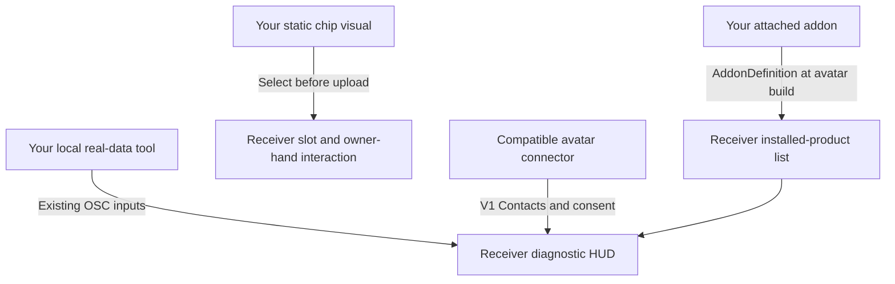

# Integrate with prokjs's personal link receiver HUD and chips

[All languages](../../README.md) · English is the source guide · Contract snapshot: 2026-11-01

## 1. Choose the integration you need

| Goal | Supported path |
| --- | --- |
| Show an attached addon in the HUD's installed-product list | Ship a schema-1 `AddonDefinition` with your own assets. |
| Offer your addon's chip visual in receiver upload setup | Set `chipVisualPrefab` on that definition; use a separate static visual-only prefab. |
| Display real heart rate or battery readings | Supply the existing OSC parameters from a local tool. |
| Connect an avatar accessory to the receiver | Use the V1 VRChat Contacts contract and respect port/viewer consent. |
| Add arbitrary sensor fields, custom HUD widgets or chip-controlled product activation | No general public interface for this is established by the current contract. Propose the feature in an issue; do not disguise unrelated data as BPM or battery. |

The **receiver owns its HUD, configured text, inventory, readings and consent**. A connector does not copy those into its own avatar. Compatible V1 connectors can view receiver-owned display content without receiving every new addon's metadata. This is not a guarantee of arbitrary future compatibility.

This repository publishes developer documentation and an explicitly synthetic OSC example. **The receiver asset, standalone integration asset and additional creator-supplied guide are not distributed here yet.** Obtain the actual receiver package separately from prokjs. Do not infer a release download from this guide. The documentation does not expose private product source or grant rights to paid assets.



## 2. Prepare a development avatar

1. Use a licensed humanoid avatar and back up the project/source scene. No avatar is supplied here.
2. The receiver's documented environment is **Unity 2022.3.22f1, VRChat Avatars SDK 3.10.6, Modular Avatar 1.18.7 and NDMF 1.14.8**, installed through VCC as appropriate. Other versions are not automatically validated.
3. Import the receiver package obtained separately. Select the original avatar outside Play Mode and run **Tools > prokjs > Personal Link Receiver > Attach to selected avatar**. A bare prefab drag is only a visual preview, not the native setup.
4. Fit the receiver manually and save the scene. Use the receiver's HUD settings/preview to configure name, optional information and language. Do not install an overlapping old receiver at the same socket.
5. PC/Built-in shaders are the documented target. Standalone Quest/Android compatibility is not established.

## 3. Register your addon without modifying the receiver

The receiver supplies the editor-only type **`Prokjs.AssetInventory.Editor.AddonDefinition`**. Do not create a second copy or rename its script. Keep its script GUID **`d9e78870673d4c149455cd26a227eb0a`** intact. A consumer needs the actual compatible receiver/framework installed; this repository alone does not install it.

1. Create your own folder, for example **`Assets/MyCyberwear`**. Put your product prefabs, meshes, materials and controllers there.
2. Within that folder choose **Assets > Create > prokjs > Addon Definition**.
3. Fill the fields below. Attach the real product to the avatar, not the definition asset.
4. Distribute your definition and your owned assets with their Unity `.meta` files. Do not bundle another copy of the shared schema or private receiver/paid assets.

| Field | Required contract | Example |
| --- | --- | --- |
| `schemaVersion` | `1`; unsupported schemas fail. | `1` |
| `id` | Unique stable product ID, not a version; no whitespace/control characters. | `mybrand.wrist-display` |
| `displayName` | Nonempty single-line text; no control characters or leading/trailing whitespace. | `Wrist Display` |
| `bodySlot` | Same text constraints as display name. | `WRIST` |
| `order` | Integer sort order; ties use ordinal stable ID. | `100` |
| `assetFolder` | Your own Unity folder containing the definition; not all of `Assets`/`Packages`. | Drag `Assets/MyCyberwear` here. |
| `prefabs` | Optional additional prefab **asset roots**, not scene instances, children or missing entries. | Your product prefab asset. |
| `chipVisualPrefab` | Optional static chip visual asset root; see section 4. | Your separately authored chip prefab. |

Attachment needs an owned folder or at least one valid prefab reference. Duplicate IDs and invalid definitions fail with a correction message; fix them rather than suppressing the error.

**What counts as installed:** real attached prefab provenance or referenced mesh/material/animation-controller assets, including inactive objects and disabled/unpacked assets. Imported folders, object names and registration alone do not establish installation. Duplicate instances show once.

**How it reaches the HUD:** NDMF bakes recognized attached addons onto the disposable build clone at avatar build/upload; source materials are not rewritten. **Refresh selected avatar inventory** updates the editor preview, not a required manual upload step. This is an upload-time inventory snapshot—not live enabled/disabled state, purchase detection or licensing. Adding/removing an addon requires another avatar build/upload to change the uploaded inventory.

## 4. Author and integrate chips

### Make the visual

Create an original mesh/material and a separate prefab asset representing the chip. Throughout this prefab hierarchy, only **Transform, MeshFilter and MeshRenderer** components are allowed, and at least one MeshRenderer is required. Do not include scripts, missing scripts, Animator, SkinnedMeshRenderer, PhysBones, contacts, colliders, lights or whole product controllers. Put functionality on your actual addon, not inside this visual-only prefab. No standard chip dimensions or automatic fitting guarantee is published here: inspect scale/orientation and clipping in the receiver setup.

Set the addon's `chipVisualPrefab` to that prefab. Leave it unassigned if you do not offer a chip. A chip visual is optional; addon registration does not require one.

### Include it in the avatar upload

1. Open the installed receiver's **HUD settings and preview > Chip assets included in upload**.
2. Choose **Starting slot**.
3. Select your entry from **Registered addon chip**, then press **Use registered chip prefab**. Alternatively assign your compliant **Chip visual prefab (upload)** directly.
4. Press **Set starting chip for selected slot**, or choose **Start selected slot empty**.
5. Inspect both slots and hand placement, save and upload the avatar with the chosen assets included.

These are editor/upload setup controls, **not an in-game store or downloadable chip catalog**. VRChat cannot import a new prefab into an already-uploaded avatar; changing the included visual requires another upload. The receiver supplies two actual passive **Blank data chip** starter visuals, not simulated paid capabilities.

### In-world interaction

- Move your **own hand** near a slot to display its owner-only hover card with the actual seated/empty/held item name and valid action.
- Make a **fresh fist/grab** to remove its chip into that hand. Open/release to rearm, return that same hand to the **original empty slot**, then make another fresh grab to insert.
- Entering hover while already holding a fist does nothing. Each hand can hold at most one chip. If one hand overlaps both targets, the **right slot takes priority**.
- Other players' hands cannot operate your chip controls. Cross-slot trading and hand-to-hand transfer are not included.
- Native saved/synced slot modes move the uploaded visual. The two integer modes consume **16 synced bits**; hover, requests and owner UI are local. This uses VRChat `GestureLeft`/`GestureRight = 1`, not a custom uploaded runtime script.

**A chip does not grant a license, activate/deactivate a separate product, load code or stream arbitrary data.** No public slot-state callback/activation API is promised here. Live chip occupancy is separate from upload-baked inventory and portrait. If you need functional chip-controlled behavior, propose an explicit API rather than coupling to private generated animator names.

## 5. Supply live data to the HUD

Enable **PC VRChat > Action Menu > Options > OSC > Enabled**. The normal local destination is **`127.0.0.1:9000`** over UDP. Every address below begins with **`/avatar/parameters/`**. Own only the inputs your tool actually supplies; do not run competing senders for the same fields or write consent controls.

| Parameter | OSC type | Meaning |
| --- | --- | --- |
| `Juice/Level` | Float (`f`) | Normalized 0–1 battery level; interpret with state. |
| `Juice/State` | Int (`i`) | 0 unknown; 1 battery; 2 charging; 3 battery-free/external/unlimited state. State 3 must reflect confirmed capability or an explicit user override, not an assumption that wired means unlimited. |
| `Juice/Heartbeat` | Bool (`T`/`F`) | Alternating battery-transport heartbeat, not a constant true and not BPM. |
| `PersonalLink/Heartbeat` | Bool (`T`/`F`) | Alternating monitoring-transport heartbeat; useful for HR-only monitoring. |
| `hr_percent` | Float (`f`) | BPM divided by 200; 120 BPM is 0.6. |
| `hr_connected` | Bool (`T`/`F`) | Valid current HR data, not merely a connected sensor socket. |

Send a changing heartbeat at approximately one-second cadence **while monitoring**, not merely while your app window is open. The generated HUD has separate eight-second changing-heartbeat watchdogs; either fresh heartbeat marks transport available. **Transport activity does not prove each sensor is fresh.** Your tool must clear `hr_connected`/HR values when its source is missing, invalid or stale, and send battery state 0 when battery data is unavailable. Stop/exit should clear owned availability; abrupt termination cannot guarantee a final packet. Another active heartbeat can keep transport available, so do not rely only on the HUD watchdog for sensor expiry.

Do not present demo input as measured data. A successful UDP send does not prove the avatar received the correct parameters. The receiver/framework declares these inputs; inspect the actual avatar OSC configuration if receipt fails. Do not duplicate incompatible animator/expression declarations.

### Run the explicitly synthetic wire example

Requires Python 3.9+; no third-party modules. From the repository root:

```sh
python examples/send_heart_rate.py --bpm 120 --seconds 3
```

This sends **synthetic 120 BPM**, `hr_connected = true` and an alternating `PersonalLink/Heartbeat` once per second, then clears its HR input. It is an encoding/integration example, **not a sensor driver**. Do not use it alongside a real HR sender or claim its output is live. Adapt the sending functions to your real source and its freshness checks; preserve the parameter types and normalization. No battery, consent or chip state is written by the example.

## 6. Connect a third-party avatar accessory

The shared V1 contact identifiers are:

| Tag | Role |
| --- | --- |
| `ProkjsPersonalLinkSocketV1` | Receiver's open socket. |
| `ProkjsPersonalLinkAvailableSocketV1` | Open unoccupied socket available for acquisition. |
| `ProkjsPersonalLinkConnectedPlugV1` | Compatible plug tip sender. |
| `ProkjsPersonalLinkViewerV1` | Eligible viewer viewpoint sender. |
| `ProkjsPersonalLinkViewerEnV1`, `ProkjsPersonalLinkViewerKoV1`, `ProkjsPersonalLinkViewerJaV1`, `ProkjsPersonalLinkViewerZhV1`, `ProkjsPersonalLinkViewerEsV1` | Matching viewer language tags. |

Use the separately supplied receiver/free plug as the practical reference when available. The free plug's contact is at its electrical nose (local +Y). Put viewer targeting at the actual avatar viewpoint, not arbitrarily on the tool mesh. Do not advertise occupied sockets as available or bypass user opt-in. A matching tag alone is not a complete latch solver or proof of compatibility: your accessory owns its native deployment, grabbing, constraints and disconnection behavior. No private HUD buffers or generated controller names are a supported third-party API.

**Port enabled** and **Share readings** start OFF; receiver **View HUD** starts ON. The receiver owner must open the port and opt in to sharing; viewer eligibility does not override those choices. Compatible connector-side viewer controls must also respect the viewer's choice. A paid cable is not required for free receiver/plug/HUD use.

The public body inventory/portrait remains public. Diagnostic information follows the receiver's gates. Geometric targeting is **not authentication, encryption or guaranteed privacy**; co-located cameras may be indistinguishable, and synced readings remain accessible outside the display. Configured names are not authenticated usernames. OSC UDP is unauthenticated/unencrypted: keep it local/trusted. Never upload credentials or secrets in HUD text, assets or bug reports.

## 7. Verification before distribution

- **Registration:** an imported-but-unattached addon stays absent; an attached addon appears once; inactive/unpacked variants still recognize real provenance. Duplicate IDs and bad references produce actionable failures.
- **Upload inventory:** verify the build-time result after changing installed addons without relying on a manual preview refresh. Ensure source materials are not modified.
- **Chips:** verify the registered visual is selectable; no rejected components; both slots, each hand, fresh-grab/rearm, original-slot insertion, right-slot overlap priority and owner-only operation behave correctly. Check empty/held/seated labels, clipping, saved state and remote replication.
- **Telemetry:** check the actual uploaded avatar receives correct float/int/bool types and normalized values. Test missing sensors, stale HR while another heartbeat continues, stop/restart and no heartbeat for over eight seconds. Unknown must remain unknown; synthetic data must remain identified as synthetic.
- **Connections:** use two actual consenting VRChat clients; test port closed/open, sharing off/on, viewer off/on, occupied socket handling, disconnect/reconnect and unrelated viewers. Test your own device's reach/constraint rules; do not assume another product's settings apply.
- **Platforms:** test desktop and PCVR/stereo as claimed, avatar scaling and the versions you advertise. Do not extrapolate Quest support or universal avatar compatibility from editor success.
- **Clean package:** import into a clean supported project; include your assets, definition and `.meta` files and required notices, not paid/private source, avatar assets, credentials or Unity caches.

Source inspection and local OSC loopback checks do not establish uploaded-avatar, two-client, physical-sensor or in-headset acceptance. No such acceptance is claimed by this repository.

## 8. Distribution and support

Keep a unique stable addon ID across releases, preserve asset GUIDs and declare the required receiver/schema version. Translate visible labels, not protocol identifiers. Use **Cyberwear** as the ecosystem category; third-party projects must not imply official endorsement. The MIT license here covers only this repository's documentation/example, not separately provided product assets, fonts, SDKs or your addon.

Open a GitHub issue with your integration type, receiver/addon versions, Unity/SDK/MA/NDMF versions, desktop/PCVR mode, expected/actual behavior and minimal steps. Remove names, private readings, tokens and Widget IDs. Propose arbitrary-data fields or chip activation APIs openly instead of modifying private receiver implementation details.
