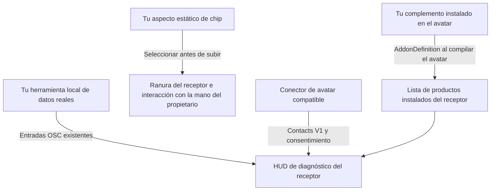

# Integración con prokjs's personal link receiver HUD y sus chips

Las herramientas usan **Tools > prokjs > [Asset] > Chip > Generate** y **Generate and install on selected avatar**. Las acciones equivalentes de actualización/eliminación usan **Upgrade installed chip** / **Remove from selected avatar**, cuando se admiten. Las raíces de prefab, archivos y etiquetas del receptor siguen **[Asset Name] Chip**: **Personal Link Receiver Chip**, **Battery Floater Chip**, **Eye Headlight Chip**. Los chips iniciales del receptor siguen siendo visuales pasivos; el nombre no concede funciones. Se conservan GUID e ID de módulo. Regenera la configuración y vuelve a subir tras actualizar.

[Todos los idiomas](../../README.md) · El inglés es la guía de referencia · Versión del contrato: 2026-11-01

## 1. Elige la integración que necesitas

| Objetivo | Vía compatible |
| --- | --- |
| Mostrar un complemento instalado en el avatar en la lista de productos instalados del HUD | Distribuye un `AddonDefinition` de esquema 1 junto con tus propios recursos. |
| Ofrecer el aspecto de chip de tu complemento en la configuración de subida del receptor | Asigna `chipVisualPrefab` en esa definición; utiliza un prefab estático independiente y exclusivamente visual. |
| Mostrar lecturas reales de frecuencia cardíaca o batería | Envía los parámetros OSC existentes desde una herramienta local. |
| Conectar un accesorio del avatar al receptor | Utiliza el contrato V1 de VRChat Contacts y respeta el consentimiento para el puerto y la visualización. |
| Añadir campos de sensores arbitrarios, widgets personalizados del HUD o activación de productos mediante chips | El contrato actual no establece una interfaz pública general para ello. Propón la función en una incidencia; no hagas pasar datos ajenos por BPM o batería. |

El **receptor es quien gestiona su HUD, el texto configurado, el inventario, las lecturas y el consentimiento**. Un conector no copia esos elementos a su propio avatar. Los conectores V1 compatibles pueden visualizar el contenido de la pantalla del receptor sin recibir los metadatos de cada nuevo complemento. Esto no garantiza una compatibilidad futura arbitraria.

Este repositorio publica documentación para desarrolladores y un ejemplo OSC expresamente sintético. **El recurso del receptor, el recurso de integración independiente y la guía adicional proporcionada por el creador aún no se distribuyen aquí.** Obtén el paquete real del receptor por separado a través de prokjs. No deduzcas de esta guía que existe una descarga de una versión publicada. La documentación no expone código fuente privado del producto ni concede derechos sobre recursos de pago.



## 2. Prepara un avatar de desarrollo

1. Utiliza un avatar humanoide para el que tengas licencia y haz una copia de seguridad del proyecto y de la escena original. Aquí no se proporciona ningún avatar.
2. El entorno documentado del receptor es **Unity 2022.3.22f1, VRChat Avatars SDK 3.10.6, Modular Avatar 1.18.7 y NDMF 1.14.8**, instalados mediante VCC según corresponda. Otras versiones no quedan validadas automáticamente.
3. Importa el paquete del receptor obtenido por separado. Selecciona el avatar original fuera de Play Mode y ejecuta **Tools > prokjs > Personal Link Receiver > Attach to selected avatar**. Arrastrar únicamente el prefab solo ofrece una vista previa visual, no la configuración nativa.
4. Ajusta manualmente el receptor y guarda la escena. Utiliza los ajustes y la vista previa del HUD del receptor para configurar el nombre, la información opcional y el idioma. No instales un receptor antiguo superpuesto en el mismo puerto de conexión.
5. El objetivo documentado es PC con shaders Built-in. No se ha establecido la compatibilidad con Quest autónomo/Android.

## 3. Registra tu complemento sin modificar el receptor

El receptor proporciona el tipo exclusivo del editor **`Prokjs.AssetInventory.Editor.AddonDefinition`**. No crees una segunda copia ni cambies el nombre de su script. Conserva intacto el GUID de su script, **`d9e78870673d4c149455cd26a227eb0a`**. Quien use la integración necesita tener instalado el receptor/framework real compatible; este repositorio por sí solo no lo instala.

1. Crea tu propia carpeta, por ejemplo **`Assets/MyCyberwear`**. Coloca allí los prefabs, las mallas, los materiales y los controladores de tu producto.
2. Dentro de esa carpeta, elige **Assets > Create > prokjs > Addon Definition**.
3. Rellena los campos indicados a continuación. Instala el producto real en el avatar, no el recurso de definición.
4. Distribuye tu definición y los recursos de tu propiedad junto con sus archivos `.meta` de Unity. No incluyas otra copia del esquema compartido ni recursos privados del receptor o de pago.

| Campo | Contrato requerido | Ejemplo |
| --- | --- | --- |
| `schemaVersion` | `1`; los esquemas no compatibles provocan un error. | `1` |
| `id` | ID de producto único y estable, no una versión; sin espacios en blanco ni caracteres de control. | `mybrand.wrist-display` |
| `displayName` | Texto no vacío de una sola línea; sin caracteres de control ni espacios en blanco al principio o al final. | `Wrist Display` |
| `bodySlot` | Las mismas restricciones de texto que para el nombre visible. | `WRIST` |
| `order` | Orden de clasificación entero; los empates se resuelven mediante el ID estable con comparación ordinal. | `100` |
| `assetFolder` | Tu propia carpeta de Unity que contiene la definición; no todo `Assets`/`Packages`. | Arrastra `Assets/MyCyberwear` aquí. |
| `prefabs` | **Raíces de recursos prefab** adicionales opcionales, no instancias de escena, objetos secundarios ni entradas ausentes. | El recurso prefab de tu producto. |
| `chipVisualPrefab` | Raíz opcional de un recurso visual estático de chip; consulta la sección 4. | El prefab de chip que hayas creado por separado. |

Para vincular el complemento se necesita una carpeta de su propiedad o al menos una referencia válida a un prefab. Los ID duplicados y las definiciones no válidas provocan un error con un mensaje que indica cómo corregirlo; corrige el problema en lugar de suprimir el error.

**Qué se considera instalado:** la procedencia real de un prefab instalado o las referencias a recursos de malla, material o controlador de animación, incluidos los objetos inactivos y los recursos deshabilitados o cuyos prefabs se hayan desempaquetado. Las carpetas importadas, los nombres de los objetos y el registro por sí solos no demuestran que un producto esté instalado. Las instancias duplicadas aparecen una sola vez.

**Cómo llega al HUD:** al compilar/subir el avatar, NDMF incorpora los complementos instalados reconocidos al clon de compilación desechable; no se reescriben los materiales originales. **Refresh selected avatar inventory** actualiza la vista previa del editor, pero no es un paso manual obligatorio para la subida. Se trata de una instantánea del inventario en el momento de la subida, no del estado de activación/desactivación en tiempo real, de detección de compras ni de licencias. Añadir o quitar un complemento requiere volver a compilar/subir el avatar para cambiar el inventario subido.

## 4. Crea e integra chips

### Crea el aspecto visual

Crea una malla y un material originales, así como un recurso prefab independiente que represente el chip. En toda la jerarquía de este prefab solo se permiten los componentes **Transform, MeshFilter y MeshRenderer**, y se requiere al menos un MeshRenderer. No incluyas scripts, scripts ausentes, Animator, SkinnedMeshRenderer, PhysBones, contactos, colliders, luces ni controladores completos del producto. Coloca la funcionalidad en tu complemento real, no dentro de este prefab exclusivamente visual.

Diseña el visual completo con **0.9 mm de ancho (X) × 14 mm de largo (Y)** y hasta **0.7 mm de relieve (Z)**; el canal del receptor mide **1.1 × 14.6 mm**. La edición actualizada reduce proporcionalmente los visuales demasiado grandes de la biblioteca para ajustarlos a ambas ranuras físicas, incluidas las escaladas por separado; no amplía ajustes intencionadamente menores. Comprueba orientación, desplazamientos e intersecciones; guarda y vuelve a subir tras los cambios. Esta corrección dimensional no establece la aceptación en VRChat.

Asigna ese prefab al campo `chipVisualPrefab` del complemento. Déjalo sin asignar si no ofreces un chip. El aspecto visual de un chip es opcional; no es necesario para registrar el complemento.

### Inclúyelo en la subida del avatar

1. Abre **HUD settings and preview > Chip assets included in upload** en el receptor instalado.
2. Elige **Starting slot**.
3. Selecciona tu entrada en **Registered addon chip** y pulsa **Use registered chip prefab**. Como alternativa, asigna directamente tu **Chip visual prefab (upload)** que cumpla los requisitos.
4. Pulsa **Set starting chip for selected slot**, o elige **Start selected slot empty**.
5. Comprueba ambas ranuras y la colocación en las manos, guarda y sube el avatar con los recursos elegidos incluidos.

Estos son controles de configuración del editor y de la subida, **no una tienda dentro del juego ni un catálogo de chips descargables**. VRChat no puede importar un nuevo prefab a un avatar ya subido; cambiar el aspecto visual incluido requiere otra subida. El receptor proporciona dos aspectos visuales iniciales reales y pasivos de **Personal Link Receiver Chip**, no capacidades de pago simuladas.

### Interacción dentro del mundo

- Acerca **tu propia mano** a una ranura para mostrar su tarjeta flotante, visible solo para el propietario, con el nombre real del elemento insertado, vacío o sostenido y la acción válida.
- Realiza un **nuevo gesto de puño/agarre** para sacar el chip y sostenerlo en esa mano. Abre la mano o suelta el agarre para rearmar la interacción, devuelve esa misma mano a la **ranura original vacía** y realiza otro nuevo agarre para insertarlo.
- Entrar en la zona de la tarjeta flotante con el puño ya cerrado no hace nada. Cada mano puede sostener como máximo un chip. Si una mano se superpone a ambos objetivos, la **ranura derecha tiene prioridad**.
- Las manos de otros jugadores no pueden accionar tus controles de chips. No se incluyen el intercambio entre ranuras ni la transferencia de una mano a otra.
- Los modos nativos guardados/sincronizados de las ranuras mueven el aspecto visual subido. Los dos modos enteros consumen **16 bits sincronizados**; la detección de proximidad, las solicitudes y la interfaz del propietario son locales. Esto utiliza `GestureLeft`/`GestureRight = 1` de VRChat, no un script de ejecución personalizado subido.

**Un chip no concede una licencia, no activa ni desactiva un producto independiente, no carga código ni transmite datos arbitrarios.** Aquí no se promete ninguna API pública de activación ni de callbacks del estado de las ranuras. La ocupación de los chips en tiempo real es independiente del inventario y del retrato incorporados durante la subida. Si necesitas comportamientos funcionales controlados por chips, propón una API explícita en lugar de depender de nombres privados de animadores generados.

## 5. Envía datos en tiempo real al HUD

Activa **PC VRChat > Action Menu > Options > OSC > Enabled**. El destino local habitual es **`127.0.0.1:9000`** mediante UDP. Todas las direcciones siguientes empiezan por **`/avatar/parameters/`**. Gestiona únicamente las entradas que tu herramienta realmente proporciona; no ejecutes emisores que compitan por los mismos campos ni escribas en los controles de consentimiento.

| Parámetro | Tipo OSC | Significado |
| --- | --- | --- |
| `Juice/Level` | Float (`f`) | Nivel de batería normalizado entre 0 y 1; debe interpretarse junto con el estado. |
| `Juice/State` | Int (`i`) | 0 desconocido; 1 batería; 2 en carga; 3 sin batería/alimentación externa/estado ilimitado. El estado 3 debe reflejar una capacidad confirmada o una anulación explícita del usuario, no la suposición de que una conexión por cable implica energía ilimitada. |
| `Juice/Heartbeat` | Bool (`T`/`F`) | Señal de actividad alternante del transporte de batería; no un valor true constante ni los BPM. |
| `PersonalLink/Heartbeat` | Bool (`T`/`F`) | Señal de actividad alternante del transporte de monitorización; útil para monitorizar únicamente la frecuencia cardíaca. |
| `hr_percent` | Float (`f`) | BPM dividido entre 200; 120 BPM equivale a 0.6. |
| `hr_connected` | Bool (`T`/`F`) | Datos actuales y válidos de frecuencia cardíaca, no simplemente una conexión abierta con el sensor. |

Envía una señal de actividad cambiante aproximadamente una vez por segundo **mientras se esté monitorizando**, no solo mientras la ventana de tu aplicación esté abierta. El HUD generado tiene temporizadores de vigilancia independientes de ocho segundos que detectan los cambios de estas señales; una señal reciente de cualquiera de los dos marca el transporte como disponible. **La actividad del transporte no demuestra que cada sensor tenga datos recientes.** Tu herramienta debe desactivar `hr_connected` y borrar los valores de frecuencia cardíaca cuando su fuente no esté disponible, no sea válida o esté obsoleta, y enviar el estado de batería 0 cuando los datos de batería no estén disponibles. Al detenerse o salir, debe restablecer la disponibilidad de las entradas que gestiona; una terminación abrupta no puede garantizar el envío de un último paquete. Otra señal de actividad en curso puede mantener el transporte disponible, así que no dependas únicamente del temporizador del HUD para detectar la caducidad de los datos de los sensores.

No presentes datos de demostración como mediciones reales. Un envío UDP correcto no demuestra que el avatar haya recibido los parámetros correctos. El receptor/framework declara estas entradas; inspecciona la configuración OSC real del avatar si falla la recepción. No dupliques declaraciones incompatibles de animadores o expresiones.

### Ejecuta el ejemplo de transmisión expresamente sintético

Requiere Python 3.9 o posterior; no necesita módulos de terceros. Desde la raíz del repositorio:

```sh
python examples/send_heart_rate.py --bpm 120 --seconds 3
```

Esto envía **120 BPM sintéticos**, `hr_connected = true` y un `PersonalLink/Heartbeat` alternante una vez por segundo; después restablece su entrada de frecuencia cardíaca. Es un ejemplo de codificación e integración, **no un controlador de sensor**. No lo utilices junto con un emisor real de frecuencia cardíaca ni afirmes que su salida son datos en tiempo real. Adapta las funciones de envío a tu fuente real y a sus comprobaciones de vigencia; conserva los tipos de los parámetros y la normalización. El ejemplo no escribe ningún estado de batería, consentimiento o chip.

## 6. Conecta un accesorio de avatar de terceros

Los identificadores de contacto V1 compartidos son:

| Etiqueta | Función |
| --- | --- |
| `ProkjsPersonalLinkSocketV1` | Puerto abierto del receptor. |
| `ProkjsPersonalLinkAvailableSocketV1` | Puerto abierto y desocupado disponible para establecer una conexión. |
| `ProkjsPersonalLinkConnectedPlugV1` | Emisor de la punta de un conector compatible. |
| `ProkjsPersonalLinkViewerV1` | Emisor del punto de vista de un observador autorizado. |
| `ProkjsPersonalLinkViewerEnV1`, `ProkjsPersonalLinkViewerKoV1`, `ProkjsPersonalLinkViewerJaV1`, `ProkjsPersonalLinkViewerZhV1`, `ProkjsPersonalLinkViewerEsV1` | Etiquetas correspondientes al idioma del observador. |

Utiliza como referencia práctica el receptor/conector gratuito suministrado por separado cuando esté disponible. El contacto del conector gratuito está en su punta eléctrica (+Y local). Sitúa el origen de la selección del observador en el punto de vista real del avatar, no arbitrariamente en la malla de la herramienta. No anuncies puertos ocupados como disponibles ni eludas el consentimiento explícito del usuario. Una etiqueta coincidente por sí sola no constituye un mecanismo completo de acoplamiento ni demuestra compatibilidad: tu accesorio es responsable de su despliegue nativo, agarre, restricciones y comportamiento de desconexión. Ningún búfer privado del HUD ni nombre de controlador generado constituye una API compatible para terceros.

**Port enabled** y **Share readings** comienzan desactivados; **View HUD** del receptor comienza activado. El propietario del receptor debe abrir el puerto y consentir explícitamente el uso compartido; que un observador cumpla los requisitos no anula esas decisiones. Los controles de visualización del lado del conector compatible también deben respetar la elección del observador. No se necesita un cable de pago para utilizar el receptor, el conector y el HUD gratuitos.

El inventario corporal y el retrato públicos siguen siendo públicos. La información de diagnóstico respeta los controles del receptor. La selección geométrica **no es autenticación, cifrado ni una garantía de privacidad**; las cámaras que coincidan en la misma ubicación pueden resultar indistinguibles y las lecturas sincronizadas siguen siendo accesibles fuera de la pantalla. Los nombres configurados no son nombres de usuario autenticados. OSC sobre UDP no está autenticado ni cifrado: mantenlo en un entorno local y de confianza. Nunca subas credenciales ni secretos en el texto del HUD, los recursos o los informes de errores.

## 7. Verificación antes de distribuir

- **Registro:** un complemento importado pero no instalado en el avatar permanece ausente; uno instalado aparece una sola vez; las variantes inactivas o desempaquetadas siguen reconociendo la procedencia real. Los ID duplicados y las referencias incorrectas producen errores que permiten corregir el problema.
- **Inventario de la subida:** verifica el resultado de la compilación después de cambiar los complementos instalados sin depender de una actualización manual de la vista previa. Asegúrate de que los materiales originales no se modifiquen.
- **Chips:** verifica que el aspecto visual registrado se pueda seleccionar; que no haya componentes rechazados; y que ambas ranuras, cada mano, el nuevo agarre/rearmado, la inserción en la ranura original, la prioridad de la ranura derecha en caso de superposición y la operación exclusiva del propietario funcionen correctamente. Comprueba las etiquetas de vacío/sostenido/insertado, las intersecciones de geometría, el estado guardado y la replicación remota.
- **Telemetría:** comprueba que el avatar realmente subido reciba los tipos float/int/bool correctos y los valores normalizados. Prueba sensores ausentes, datos de frecuencia cardíaca obsoletos mientras continúa otra señal de actividad, la detención y el reinicio, y la ausencia de señales de actividad durante más de ocho segundos. Lo desconocido debe seguir siendo desconocido; los datos sintéticos deben seguir identificándose como sintéticos.
- **Conexiones:** utiliza dos clientes reales de VRChat con el consentimiento de ambos usuarios; prueba el puerto cerrado/abierto, el uso compartido desactivado/activado, la visualización desactivada/activada, el tratamiento de puertos ocupados, la desconexión/reconexión y observadores ajenos a la conexión. Prueba las reglas de alcance y restricciones de tu propio dispositivo; no supongas que se aplican los ajustes de otro producto.
- **Plataformas:** prueba escritorio y PCVR/estéreo según lo que anuncies, el escalado del avatar y las versiones que declares compatibles. No deduzcas compatibilidad con Quest ni con todos los avatares a partir del éxito en el editor.
- **Paquete limpio:** importa el paquete en un proyecto limpio con un entorno compatible; incluye tus recursos, la definición, los archivos `.meta` y los avisos obligatorios, no código fuente de pago o privado, recursos de avatar, credenciales ni cachés de Unity.

La inspección del código fuente y las comprobaciones locales de bucle de retorno OSC no demuestran la validación con un avatar subido, dos clientes, sensores físicos ni dentro de un visor. Este repositorio no afirma haber superado ninguna de esas validaciones.

## 8. Distribución y soporte

Mantén un ID de complemento único y estable entre versiones, conserva los GUID de los recursos y declara la versión de receptor/esquema requerida. Traduce las etiquetas visibles, no los identificadores del protocolo. Utiliza **Cyberwear** como categoría del ecosistema; los proyectos de terceros no deben dar a entender que cuentan con respaldo oficial. La licencia MIT de este repositorio solo cubre su documentación y su ejemplo, no los recursos de producto, las fuentes tipográficas o los SDK suministrados por separado, ni tu complemento.

Abre una incidencia de GitHub con el tipo de integración, las versiones del receptor y del complemento, las versiones de Unity/SDK/MA/NDMF, el modo escritorio/PCVR, el comportamiento esperado y el real, y los pasos mínimos para reproducirlo. Elimina nombres, lecturas privadas, tokens e ID de widgets. Propón abiertamente los campos de datos arbitrarios o las API de activación de chips en lugar de modificar detalles privados de la implementación del receptor.
