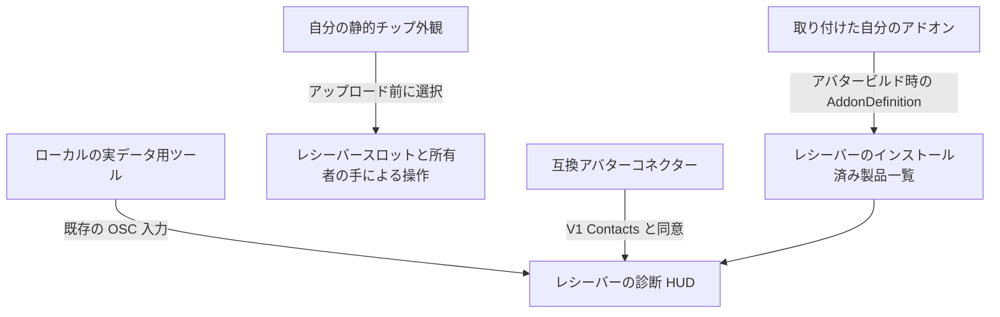

# prokjs's personal link receiver HUD とチップへの連携

[すべての言語](../../README.md) · 原文は英語版です · 契約仕様の基準日: 2026-11-01

## 1. 必要な連携方法を選ぶ

| 目的 | サポートされる方法 |
| --- | --- |
| アバターに取り付けたアドオンを HUD のインストール済み製品一覧に表示する | 自分のアセットとともに、スキーマ 1 の `AddonDefinition` を配布します。 |
| レシーバーのアップロード設定でアドオンのチップ外観を選べるようにする | 定義の `chipVisualPrefab` を設定します。静的な外観専用の独立したプレハブを使用してください。 |
| 実際の心拍数やバッテリーの測定値を表示する | ローカルツールから既存の OSC パラメーターに値を送信します。 |
| アバターアクセサリーをレシーバーに接続する | V1 VRChat Contacts 契約仕様を使用し、ポートと閲覧者の同意設定を尊重します。 |
| 任意のセンサーフィールド、独自の HUD ウィジェット、チップによる製品の有効化を追加する | 現在の契約仕様では、これらに対応する汎用の公開インターフェースは確立されていません。Issue で機能を提案してください。無関係なデータを BPM やバッテリー値に見せかけないでください。 |

**HUD、設定済みテキスト、インベントリ、測定値、同意設定はレシーバーが管理します。** コネクターはそれらを自分のアバターにコピーしません。互換性のある V1 コネクターは、新しいアドオンごとのメタデータを受け取らなくても、レシーバーが管理する表示内容を閲覧できます。ただし、将来のあらゆる変更に対する互換性を保証するものではありません。

このリポジトリでは、開発者向けドキュメントと、合成データであることを明示した OSC サンプルを公開しています。**レシーバーアセット、単体の連携用アセット、制作者提供の追加ガイドは、まだここでは配布していません。** 実際のレシーバーパッケージは prokjs から別途入手してください。このガイドがあることをもって、リリースのダウンロードが提供されていると判断しないでください。このドキュメントは非公開の製品ソースを公開するものでも、有料アセットの権利を付与するものでもありません。



## 2. 開発用アバターを準備する

1. 使用許諾を得た Humanoid アバターを使用し、プロジェクトと元のシーンをバックアップしてください。ここではアバターを提供していません。
2. レシーバーのドキュメント上の環境は **Unity 2022.3.22f1、VRChat Avatars SDK 3.10.6、Modular Avatar 1.18.7、NDMF 1.14.8** です。必要に応じて VCC 経由で導入してください。他のバージョンが自動的に検証済みになるわけではありません。
3. 別途入手したレシーバーパッケージをインポートします。Play Mode ではない状態で元のアバターを選択し、**Tools > prokjs > Personal Link Receiver > Attach to selected avatar** を実行します。プレハブを単にドラッグするだけでは外観のプレビューにしかならず、正式なセットアップにはなりません。
4. レシーバーの位置やサイズを手動で合わせ、シーンを保存します。レシーバーの HUD 設定・プレビューで名前、任意の追加情報、言語を設定してください。同じソケットに旧レシーバーを重ねて取り付けないでください。
5. ドキュメント上の対象は PC / Built-in シェーダーです。スタンドアロン Quest / Android との互換性は確立されていません。

## 3. レシーバーを変更せずにアドオンを登録する

レシーバーはエディター専用の型 **`Prokjs.AssetInventory.Editor.AddonDefinition`** を提供します。同じ型を別途作成したり、そのスクリプトの名前を変更したりしないでください。スクリプトの GUID **`d9e78870673d4c149455cd26a227eb0a`** を維持してください。利用者には実際に互換性のあるレシーバー／フレームワークのインストールが必要です。このリポジトリだけではインストールされません。

1. **`Assets/MyCyberwear`** など、自分のフォルダーを作成します。製品のプレハブ、メッシュ、マテリアル、コントローラーをその中に配置してください。
2. そのフォルダー内で **Assets > Create > prokjs > Addon Definition** を選択します。
3. 以下のフィールドを入力します。アバターに取り付けるのは定義アセットではなく、実際の製品です。
4. 定義と自分が権利を持つアセットを、Unity の `.meta` ファイルとともに配布します。共有スキーマの別コピーや、非公開のレシーバーアセット／有料アセットを同梱しないでください。

| フィールド | 必須の契約仕様 | 例 |
| --- | --- | --- |
| `schemaVersion` | `1`。未対応のスキーマはエラーになります。 | `1` |
| `id` | バージョンではなく、一意で安定した製品 ID。空白文字・制御文字は使用できません。 | `mybrand.wrist-display` |
| `displayName` | 空でない単一行のテキスト。制御文字、先頭・末尾の空白は使用できません。 | `Wrist Display` |
| `bodySlot` | 表示名と同じテキスト制約が適用されます。 | `WRIST` |
| `order` | 整数の並び順。同値の場合は安定した ID の序数順を使用します。 | `100` |
| `assetFolder` | 定義を含む、自分が所有する Unity フォルダー。`Assets` 全体や `Packages` 全体は指定できません。 | `Assets/MyCyberwear` をここにドラッグします。 |
| `prefabs` | 任意の追加プレハブの**アセットルート**。シーン内インスタンス、子オブジェクト、参照切れの項目は使用できません。 | 自分の製品のプレハブアセット。 |
| `chipVisualPrefab` | 任意の静的チップ外観のアセットルート。セクション 4 を参照してください。 | 別途制作したチッププレハブ。 |

取り付けの認識には、所有するフォルダー、または少なくとも 1 つの有効なプレハブ参照が必要です。ID の重複や無効な定義があると、修正案内を伴うエラーになります。エラーを抑制せず、原因を修正してください。

**インストール済みと判定される条件:** 実際に取り付けられたプレハブの由来、または参照されているメッシュ／マテリアル／アニメーションコントローラーのアセットに基づきます。非アクティブなオブジェクトや、無効化されたもの／Unpack 済みのものも対象です。フォルダーのインポート、オブジェクト名、登録だけではインストール済みとは判定されません。重複したインスタンスは 1 回だけ表示されます。

**HUD に反映される仕組み:** アバターのビルド／アップロード時に、NDMF が認識済みの取り付けアドオンを使い捨てのビルド用クローンにベイクします。元のマテリアルは書き換えません。**Refresh selected avatar inventory** はエディタープレビューを更新する機能であり、アップロード前に必須の手動操作ではありません。これはアップロード時点のインベントリのスナップショットです。実行時の有効／無効状態、購入検出、ライセンス管理ではありません。アドオンの追加・削除をアップロード済みインベントリに反映するには、アバターの再ビルド／再アップロードが必要です。

## 4. チップを制作して組み込む

### 外観を作成する

オリジナルのメッシュ／マテリアルと、チップを表す独立したプレハブアセットを作成します。このプレハブの階層全体で使用できるコンポーネントは **Transform、MeshFilter、MeshRenderer** のみで、少なくとも 1 つの MeshRenderer が必要です。スクリプト、Missing Script、Animator、SkinnedMeshRenderer、PhysBones、Contacts、コライダー、ライト、製品全体のコントローラーを含めないでください。機能はこの外観専用プレハブではなく、実際のアドオン側に実装してください。ここでは標準のチップ寸法や自動フィッティングの保証は公開していません。レシーバーのセットアップでスケール、向き、めり込みを確認してください。

アドオンの `chipVisualPrefab` にそのプレハブを設定します。チップを提供しない場合は未設定のままにしてください。チップの外観は任意であり、アドオン登録に必須ではありません。

### アバターのアップロードに含める

1. インストール済みレシーバーの **HUD settings and preview > Chip assets included in upload** を開きます。
2. **Starting slot** を選択します。
3. **Registered addon chip** から自分の項目を選び、**Use registered chip prefab** を押します。または、仕様に適合する **Chip visual prefab (upload)** を直接指定します。
4. **Set starting chip for selected slot** を押すか、**Start selected slot empty** を選びます。
5. 両方のスロットと手で保持する位置を確認し、保存して、選択したアセットを含むアバターをアップロードします。

これらはエディター／アップロード用の設定であり、**ゲーム内ストアやダウンロード式のチップカタログではありません**。VRChat では、アップロード済みのアバターに新しいプレハブを取り込めません。含める外観を変更するには再アップロードが必要です。レシーバーには、実際に使用できる受動的な **Blank data chip** の初期外観が 2 つ付属します。有料機能を模擬するものではありません。

### ワールド内での操作

- **自分の手**をスロットに近づけると、所有者だけに表示されるホバーカードが現れます。実際に装着中／空／手で保持中のアイテム名と、有効な操作が表示されます。
- **新たに拳を握る／グラブする**と、その手でチップを取り出します。手を開く／リリースして次の操作を受け付ける状態に戻し、同じ手を**元の空スロット**へ戻して、再び新たにグラブすると挿入できます。
- すでに拳を握った状態でホバー範囲に入っても、何も起こりません。片手で保持できるチップは最大 1 つです。片手が両方の対象に重なった場合は、**右スロットが優先**されます。
- 他のプレイヤーの手では、自分のチップ操作を行えません。別スロットへの移動や、手から手への受け渡しには対応していません。
- ネイティブの保存・同期されるスロットモードによって、アップロード済みの外観を移動します。2 つの整数モードは**同期ビットを 16 ビット**消費します。ホバー、操作要求、所有者 UI はローカルです。これは VRChat の `GestureLeft`/`GestureRight = 1` を使用するもので、独自のアップロード済みランタイムスクリプトではありません。

**チップはライセンスを付与せず、別製品の有効化／無効化、コードの読み込み、任意データのストリーミングも行いません。** ここではスロット状態の公開コールバック／有効化 API を提供すると約束していません。実行時のチップ占有状態は、アップロード時にベイクされたインベントリやポートレートとは別です。チップによる機能制御が必要な場合は、非公開の自動生成 Animator 名に依存せず、明示的な API を提案してください。

## 5. HUD にリアルタイムデータを送る

**PC VRChat > Action Menu > Options > OSC > Enabled** を有効にします。通常のローカル送信先は UDP の **`127.0.0.1:9000`** です。以下のアドレスはすべて **`/avatar/parameters/`** で始まります。自分のツールが実際に提供する入力だけを管理してください。同じフィールドに複数の送信元から競合する値を送ったり、同意設定のコントロールへ書き込んだりしないでください。

| パラメーター | OSC 型 | 意味 |
| --- | --- | --- |
| `Juice/Level` | Float (`f`) | 0–1 に正規化したバッテリー残量。状態と合わせて解釈します。 |
| `Juice/State` | Int (`i`) | 0 不明、1 バッテリー駆動、2 充電中、3 バッテリー不要／外部電源／無制限の状態。状態 3 は、確認済みの能力またはユーザーによる明示的な上書き設定を反映する必要があります。有線なら無制限という推測で設定してはいけません。 |
| `Juice/Heartbeat` | Bool (`T`/`F`) | 値が交互に変わるバッテリーデータ転送のハートビート。常時 true でも、BPM でもありません。 |
| `PersonalLink/Heartbeat` | Bool (`T`/`F`) | 値が交互に変わるモニタリングデータ転送のハートビート。心拍数のみのモニタリングにも使用できます。 |
| `hr_percent` | Float (`f`) | BPM を 200 で割った値。120 BPM は 0.6 です。 |
| `hr_connected` | Bool (`T`/`F`) | 現在の有効な心拍数データがあることを示します。センサーのソケットが接続されているだけでは不十分です。 |

アプリのウィンドウが開いている間というだけでなく、**モニタリング中**に、およそ 1 秒間隔で値が変化するハートビートを送信してください。生成される HUD には、ハートビートの変化を監視する独立した 8 秒のウォッチドッグがあり、どちらかのハートビートが新鮮であれば転送が利用可能と判定されます。**転送の動作は、各センサーのデータが新鮮である証拠にはなりません。** データソースが存在しない、無効、または古くなった場合、ツールは `hr_connected` と心拍数値をクリアし、バッテリーデータを利用できない場合はバッテリー状態 0 を送る必要があります。停止／終了時には、自分が管理する利用可否の状態をクリアしてください。ただし、異常終了では最終パケットの送信を保証できません。別のハートビートが動作し続けると転送は利用可能なままになるため、センサーデータの期限切れ判定を HUD のウォッチドッグだけに依存しないでください。

デモ入力を測定データとして示さないでください。UDP 送信の成功は、アバターが正しいパラメーターを受信した証拠にはなりません。これらの入力はレシーバー／フレームワークが宣言します。受信に失敗する場合は、実際のアバターの OSC 設定を調べてください。互換性のない Animator／Expression の宣言を重複して追加しないでください。

### 合成データであることを明示した通信サンプルを実行する

Python 3.9 以上が必要です。サードパーティーモジュールは不要です。リポジトリのルートから実行します。

```sh
python examples/send_heart_rate.py --bpm 120 --seconds 3
```

これは**合成の 120 BPM**、`hr_connected = true`、交互に値が変わる `PersonalLink/Heartbeat` を 1 秒に 1 回送信し、最後に自身の心拍数入力をクリアします。エンコーディング／連携のサンプルであり、**センサードライバーではありません**。実際の心拍数送信ツールと同時に使用したり、出力がリアルタイムの測定値だと主張したりしないでください。送信関数を実際のデータソースとその鮮度チェックに合わせて変更し、パラメーターの型と正規化は維持してください。このサンプルはバッテリー、同意設定、チップ状態には一切書き込みません。

## 6. サードパーティー製アバターアクセサリーを接続する

共有の V1 Contact 識別子は以下のとおりです。

| タグ | 役割 |
| --- | --- |
| `ProkjsPersonalLinkSocketV1` | レシーバーの開いているソケット。 |
| `ProkjsPersonalLinkAvailableSocketV1` | 接続を取得できる、開いていて未使用のソケット。 |
| `ProkjsPersonalLinkConnectedPlugV1` | 互換プラグ先端の Sender。 |
| `ProkjsPersonalLinkViewerV1` | 閲覧条件を満たす閲覧者の視点 Sender。 |
| `ProkjsPersonalLinkViewerEnV1`, `ProkjsPersonalLinkViewerKoV1`, `ProkjsPersonalLinkViewerJaV1`, `ProkjsPersonalLinkViewerZhV1`, `ProkjsPersonalLinkViewerEsV1` | 閲覧者の言語に対応するタグ。 |

別途提供されるレシーバー／無料プラグが利用可能な場合は、それらを実装上の参考にしてください。無料プラグの Contact は電気的な先端部分（ローカル +Y）にあります。閲覧者のターゲット位置は、ツールのメッシュ上の適当な位置ではなく、実際のアバター視点に配置してください。使用中のソケットを利用可能として通知したり、ユーザーのオプトインを回避したりしないでください。タグが一致するだけでは、完全な接続固定処理や互換性の証明にはなりません。アクセサリー自身が、ネイティブの展開、グラブ、Constraint、切断の動作を管理する必要があります。非公開の HUD バッファーや自動生成コントローラー名は、サポート対象のサードパーティー API ではありません。

**Port enabled** と **Share readings** の初期値は OFF、レシーバーの **View HUD** の初期値は ON です。レシーバー所有者がポートを開き、測定値の共有に同意する必要があります。閲覧条件を満たしていても、これらの選択は上書きされません。互換コネクター側の閲覧者コントロールも、閲覧者自身の選択を尊重する必要があります。無料のレシーバー／プラグ／HUD を利用するために、有料ケーブルは必要ありません。

公開のボディインベントリ／ポートレートは公開されたままです。診断情報にはレシーバーの許可条件が適用されます。幾何学的なターゲティングは、**認証、暗号化、プライバシーの保証ではありません**。同じ場所にあるカメラは区別できない場合があり、同期された測定値には表示の外からもアクセスできます。設定された名前は認証済みユーザー名ではありません。OSC UDP には認証も暗号化もありません。ローカルの信頼できる環境に限定してください。HUD テキスト、アセット、不具合報告に認証情報や秘密情報を含めてアップロードしないでください。

## 7. 配布前の検証

- **登録:** インポートしただけで未装着のアドオンは表示されず、装着済みのアドオンは 1 回だけ表示されることを確認します。非アクティブ／Unpack 済みのバリエーションでも、実際の由来が認識されることを確認してください。ID の重複や不正な参照では、修正に役立つエラーが出る必要があります。
- **アップロード時のインベントリ:** インストール済みアドオンを変更した後、手動のプレビュー更新に依存せず、ビルド時の結果を検証します。元のマテリアルが変更されていないことを確認してください。
- **チップ:** 登録した外観を選択できること、禁止されたコンポーネントがないこと、両スロット、左右それぞれの手、新たなグラブ／操作の再受付、元のスロットへの挿入、重なった場合の右スロット優先、所有者のみの操作が正しく動作することを検証します。空／保持中／装着中のラベル、めり込み、保存状態、リモートへの同期を確認してください。
- **テレメトリー:** 実際にアップロードしたアバターが、正しい float／int／bool 型と正規化された値を受信することを確認します。センサー不在、別のハートビートが継続している間に心拍数データだけが古くなる場合、停止／再開、8 秒を超えるハートビート不在をテストしてください。不明な状態は不明のまま、合成データは合成と識別できる状態を維持する必要があります。
- **接続:** 実際に同意した 2 つの VRChat クライアントを使用します。ポートの閉／開、共有の OFF／ON、閲覧の OFF／ON、使用中ソケットの処理、切断／再接続、無関係な閲覧者をテストしてください。自分のデバイスの到達範囲／Constraint のルールをテストし、他製品の設定がそのまま適用されると想定しないでください。
- **プラットフォーム:** 対応を表明するデスクトップと PCVR／ステレオ、アバターのスケーリング、公表するバージョンをテストします。エディターでの成功から Quest 対応やあらゆるアバターとの互換性を推測しないでください。
- **クリーンなパッケージ:** サポート対象のクリーンなプロジェクトにインポートします。自分のアセット、定義、`.meta` ファイル、必要な告知を含め、有料／非公開ソース、アバターアセット、認証情報、Unity キャッシュは含めないでください。

ソースの確認やローカルの OSC ループバックチェックでは、アップロード済みアバター、2 クライアント、実センサー、ヘッドセット内での受け入れ検証を実施したことにはなりません。このリポジトリでは、そのような受け入れ検証を実施済みとは主張していません。

## 8. 配布とサポート

リリースをまたいで一意で安定したアドオン ID を維持し、アセット GUID を保持し、必要なレシーバー／スキーマのバージョンを明記してください。翻訳するのは表示ラベルであり、プロトコル識別子ではありません。エコシステムのカテゴリー名には **Cyberwear** を使用してください。サードパーティープロジェクトは公式の推奨や承認を受けていると誤解させてはいけません。ここの MIT ライセンスが適用されるのは、このリポジトリのドキュメントとサンプルのみです。別途提供される製品アセット、フォント、SDK、自分のアドオンには適用されません。

GitHub Issue には、連携の種類、レシーバー／アドオンのバージョン、Unity／SDK／MA／NDMF のバージョン、デスクトップ／PCVR モード、期待する動作と実際の動作、最小限の再現手順を記載してください。名前、非公開の測定値、トークン、Widget ID は削除してください。任意データ用フィールドやチップ有効化 API が必要な場合は、レシーバーの非公開の実装詳細を変更するのではなく、公開の場で提案してください。
