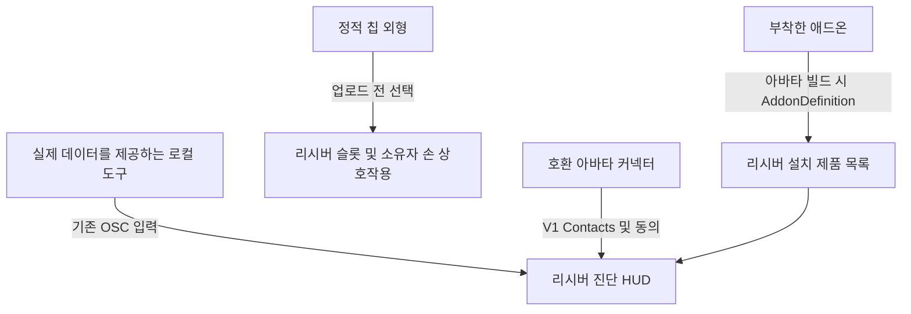

# prokjs's personal link receiver HUD 및 칩 연동하기

칩 도구는 **Tools > prokjs > [Asset] > Chip > Generate** 및 **Generate and install on selected avatar**로 통일됩니다. 지원되는 업그레이드/제거 작업은 **Upgrade installed chip** / **Remove from selected avatar**입니다. 프리팹 루트·파일명·리시버 표시는 **[Asset Name] Chip** 형식으로 **Personal Link Receiver Chip**, **Battery Floater Chip**, **Eye Headlight Chip**을 사용합니다. 리시버 기본 칩은 여전히 수동적 외형이며 이름이 제품 기능을 부여하지 않습니다. 에셋 GUID와 런타임 모듈 ID는 유지됩니다. 업데이트 후 칩 설정을 다시 생성하고 재업로드하세요.

[모든 언어](../../README.md) · 원문 가이드는 영어입니다 · 계약 기준일: 2026-11-01

## 1. 필요한 연동 방식 선택

| 목표 | 지원되는 방법 |
| --- | --- |
| 부착된 애드온을 HUD의 설치 제품 목록에 표시 | 자체 에셋과 함께 스키마 1의 `AddonDefinition`을 배포합니다. |
| 리시버 업로드 설정에서 애드온의 칩 외형을 선택할 수 있게 제공 | 해당 정의의 `chipVisualPrefab`을 설정합니다. 별도의 정적 외형 전용 프리팹을 사용합니다. |
| 실제 심박수 또는 배터리 측정값 표시 | 로컬 도구에서 기존 OSC 파라미터를 제공합니다. |
| 아바타 액세서리를 리시버에 연결 | V1 VRChat Contacts 계약을 사용하고 포트/뷰어 동의 설정을 준수합니다. |
| 임의의 센서 필드, 사용자 정의 HUD 위젯 또는 칩으로 제어하는 제품 활성화 추가 | 현재 계약에는 이를 위한 범용 공개 인터페이스가 정립되어 있지 않습니다. 이슈로 기능을 제안하세요. 관련 없는 데이터를 BPM이나 배터리로 위장하지 마세요. |

**HUD, 설정된 텍스트, 인벤토리, 측정값 및 동의 설정의 소유 주체는 리시버입니다.** 커넥터는 이를 자신의 아바타에 복사하지 않습니다. 호환되는 V1 커넥터는 새 애드온마다 메타데이터를 전달받지 않아도 리시버 소유의 표시 콘텐츠를 볼 수 있습니다. 이는 향후 모든 기능과의 호환성을 보장한다는 뜻이 아닙니다.

이 저장소는 개발자 문서와 합성 데이터임을 명시한 OSC 예제를 공개합니다. **리시버 에셋, 독립형 연동 에셋, 제작자가 별도로 제공하는 추가 가이드는 아직 여기서 배포하지 않습니다.** 실제 리시버 패키지는 prokjs에게 별도로 받으세요. 이 가이드만 보고 다운로드 가능한 릴리스가 있다고 판단하지 마세요. 이 문서는 비공개 제품 소스를 공개하거나 유료 에셋에 대한 권리를 부여하지 않습니다.



## 2. 개발용 아바타 준비

1. 사용 권한이 있는 휴머노이드 아바타를 사용하고 프로젝트/원본 씬을 백업합니다. 여기서는 아바타를 제공하지 않습니다.
2. 리시버의 문서화된 환경은 **Unity 2022.3.22f1, VRChat Avatars SDK 3.10.6, Modular Avatar 1.18.7, NDMF 1.14.8**이며, 해당되는 항목은 VCC를 통해 설치합니다. 다른 버전은 자동으로 검증된 것으로 간주하지 않습니다.
3. 별도로 받은 리시버 패키지를 임포트합니다. Play Mode가 아닌 상태에서 원본 아바타를 선택하고 **Tools > prokjs > Personal Link Receiver > Attach to selected avatar**를 실행합니다. 프리팹을 단순히 드래그하는 것은 외형 미리보기일 뿐, 정식 설치 절차가 아닙니다.
4. 리시버 위치를 수동으로 맞추고 씬을 저장합니다. 리시버의 HUD 설정/미리보기에서 이름, 선택적 정보, 언어를 설정합니다. 같은 소켓에 이전 리시버를 겹쳐 설치하지 마세요.
5. 문서화된 대상은 PC/Built-in 셰이더입니다. 독립 실행형 Quest/Android 호환성은 확립되어 있지 않습니다.

## 3. 리시버를 수정하지 않고 애드온 등록

리시버는 에디터 전용 타입 **`Prokjs.AssetInventory.Editor.AddonDefinition`**을 제공합니다. 복사본을 새로 만들거나 스크립트 이름을 바꾸지 마세요. 스크립트 GUID **`d9e78870673d4c149455cd26a227eb0a`**를 그대로 유지하세요. 사용자는 실제로 호환되는 리시버/프레임워크를 설치해야 합니다. 이 저장소만으로는 설치되지 않습니다.

1. **`Assets/MyCyberwear`**와 같은 자체 폴더를 만듭니다. 제품 프리팹, 메시, 머티리얼, 컨트롤러를 그 안에 넣습니다.
2. 해당 폴더에서 **Assets > Create > prokjs > Addon Definition**을 선택합니다.
3. 아래 필드를 입력합니다. 아바타에는 정의 에셋이 아닌 실제 제품을 부착합니다.
4. 정의와 소유한 에셋을 Unity `.meta` 파일과 함께 배포합니다. 공유 스키마의 또 다른 복사본이나 비공개 리시버/유료 에셋을 함께 배포하지 마세요.

| 필드 | 필수 계약 | 예시 |
| --- | --- | --- |
| `schemaVersion` | `1`. 지원하지 않는 스키마는 실패합니다. | `1` |
| `id` | 버전이 아닌, 고유하고 안정적인 제품 ID. 공백/제어 문자를 사용할 수 없습니다. | `mybrand.wrist-display` |
| `displayName` | 비어 있지 않은 한 줄 텍스트. 제어 문자나 앞뒤 공백을 사용할 수 없습니다. | `Wrist Display` |
| `bodySlot` | 표시 이름과 동일한 텍스트 제약 조건을 적용합니다. | `WRIST` |
| `order` | 정수 정렬 순서. 값이 같으면 안정적 ID의 서수 순서로 정렬합니다. | `100` |
| `assetFolder` | 정의를 포함하는 자체 Unity 폴더. `Assets`/`Packages` 전체를 지정하면 안 됩니다. | `Assets/MyCyberwear`를 여기에 드래그합니다. |
| `prefabs` | 선택적 추가 프리팹 **에셋 루트**. 씬 인스턴스, 자식 오브젝트 또는 누락된 항목은 안 됩니다. | 제품 프리팹 에셋. |
| `chipVisualPrefab` | 선택적 정적 칩 외형 에셋 루트. 4절을 참고하세요. | 별도로 제작한 칩 프리팹. |

부착을 인식하려면 소유한 폴더 또는 유효한 프리팹 참조가 하나 이상 필요합니다. 중복 ID와 잘못된 정의는 수정 안내 메시지와 함께 실패합니다. 오류를 숨기지 말고 원인을 수정하세요.

**설치된 것으로 인정되는 항목:** 실제로 부착된 프리팹의 출처 정보 또는 참조된 메시/머티리얼/애니메이션 컨트롤러 에셋을 기준으로 합니다. 비활성 오브젝트와 비활성화되거나 언팩된 에셋도 포함됩니다. 폴더 임포트, 오브젝트 이름 또는 등록만으로는 설치를 입증하지 못합니다. 중복 인스턴스는 한 번만 표시됩니다.

**HUD에 반영되는 과정:** 아바타 빌드/업로드 시 NDMF가 인식된 부착 애드온을 일회용 빌드 복제본에 베이크하며, 원본 머티리얼을 다시 쓰지 않습니다. **Refresh selected avatar inventory**는 에디터 미리보기를 갱신하는 기능이며, 업로드에 필수인 수동 단계가 아닙니다. 이는 업로드 시점의 인벤토리 스냅샷이며, 실시간 활성화/비활성화 상태, 구매 감지 또는 라이선스 판정이 아닙니다. 애드온을 추가/제거한 뒤 업로드된 인벤토리를 바꾸려면 아바타를 다시 빌드/업로드해야 합니다.

## 4. 칩 제작 및 연동

### 외형 제작

칩을 나타내는 독창적인 메시/머티리얼과 별도의 프리팹 에셋을 만듭니다. 이 프리팹 계층 전체에는 **Transform, MeshFilter, MeshRenderer** 컴포넌트만 허용되며, MeshRenderer가 하나 이상 있어야 합니다. 스크립트, 누락된 스크립트, Animator, SkinnedMeshRenderer, PhysBones, Contacts, 콜라이더, 조명 또는 제품 컨트롤러 전체를 포함하지 마세요. 기능은 외형 전용 프리팹이 아니라 실제 애드온에 구현하세요.

전체 외형은 **너비 0.9 mm(X) × 길이 14 mm(Y)**, 최대 **돌출 두께 0.7 mm(Z)**로 만드세요. 리시버 홈은 **1.1 × 14.6 mm**입니다. 업데이트된 리시버 편집 기능은 너무 큰 라이브러리 외형을 비율을 유지해 두 실제 슬롯에 맞추며, 개별 슬롯의 확대·축소도 반영합니다. 의도적으로 작게 맞춘 외형은 확대하지 않습니다. 방향, 오프셋, 겹침을 확인하고 변경 후 저장·재업로드하세요. 이 크기 수정이 실제 VRChat 검증을 의미하지는 않습니다.

애드온의 `chipVisualPrefab`에 이 프리팹을 지정합니다. 칩을 제공하지 않으면 미지정 상태로 둡니다. 칩 외형은 선택 사항이며, 애드온 등록에 필수는 아닙니다.

### 아바타 업로드에 포함

1. 설치된 리시버의 **HUD settings and preview > Chip assets included in upload**를 엽니다.
2. **Starting slot**을 선택합니다.
3. **Registered addon chip**에서 항목을 선택한 다음 **Use registered chip prefab**을 누릅니다. 또는 규격을 준수하는 **Chip visual prefab (upload)**를 직접 지정합니다.
4. **Set starting chip for selected slot**을 누르거나 **Start selected slot empty**를 선택합니다.
5. 양쪽 슬롯과 손에서의 배치를 확인하고 저장한 뒤, 선택한 에셋이 포함되도록 아바타를 업로드합니다.

이 항목들은 에디터/업로드 설정용이며, **게임 내 상점이나 다운로드 가능한 칩 카탈로그가 아닙니다.** VRChat은 이미 업로드된 아바타에 새 프리팹을 임포트할 수 없습니다. 포함된 외형을 바꾸려면 다시 업로드해야 합니다. 리시버는 실제로 사용할 수 있는 수동형 **Personal Link Receiver Chip** 초기 외형 두 개를 제공하며, 유료 기능을 흉내 낸 것이 아닙니다.

### 월드 내 상호작용

- **자신의 손**을 슬롯 가까이 가져가면 실제 장착/비어 있음/손에 든 항목의 이름과 가능한 동작을 보여 주는 소유자 전용 호버 카드가 표시됩니다.
- **새로 주먹을 쥐거나 잡기 동작**을 하면 칩을 빼서 그 손에 들 수 있습니다. 손을 펴거나 잡기를 해제하여 다음 동작을 준비하고, 같은 손을 **원래의 빈 슬롯**으로 되돌린 다음 새로 잡기 동작을 해야 삽입됩니다.
- 이미 주먹을 쥔 상태로 호버 영역에 들어오면 아무 일도 일어나지 않습니다. 각 손에는 최대 한 개의 칩만 들 수 있습니다. 한 손이 두 대상에 모두 겹치면 **오른쪽 슬롯이 우선**합니다.
- 다른 플레이어의 손으로는 자신의 칩 컨트롤을 조작할 수 없습니다. 슬롯 간 교환과 손에서 다른 손으로 전달하는 기능은 포함되지 않습니다.
- 네이티브 저장/동기화 슬롯 모드가 업로드된 외형을 이동시킵니다. 두 정수 모드는 **동기화 비트 16개**를 사용하며, 호버, 요청, 소유자 UI는 로컬입니다. 이는 사용자 정의 런타임 스크립트를 업로드하는 방식이 아니라 VRChat의 `GestureLeft`/`GestureRight = 1`을 사용합니다.

**칩은 라이선스를 부여하거나, 별도 제품을 활성화/비활성화하거나, 코드를 로드하거나, 임의의 데이터를 스트리밍하지 않습니다.** 여기서는 공개 슬롯 상태 콜백/활성화 API를 약속하지 않습니다. 실시간 칩 점유 상태는 업로드 시 베이크된 인벤토리 및 초상 이미지와 별개입니다. 칩으로 제어하는 기능이 필요하면 비공개 생성 애니메이터 이름에 의존하지 말고 명시적인 API를 제안하세요.

## 5. HUD에 실시간 데이터 제공

**PC VRChat > Action Menu > Options > OSC > Enabled**를 켭니다. 일반적인 로컬 전송 대상은 UDP **`127.0.0.1:9000`**입니다. 아래 주소는 모두 **`/avatar/parameters/`**로 시작합니다. 도구가 실제로 제공하는 입력만 담당하세요. 같은 필드에 여러 송신기를 동시에 실행하거나 동의 제어값을 쓰지 마세요.

| 파라미터 | OSC 타입 | 의미 |
| --- | --- | --- |
| `Juice/Level` | Float (`f`) | 0–1로 정규화한 배터리 잔량. 상태와 함께 해석합니다. |
| `Juice/State` | Int (`i`) | 0 알 수 없음, 1 배터리 사용, 2 충전 중, 3 배터리 불필요/외부 전원/무제한 상태. 상태 3은 확인된 기능 또는 명시적인 사용자 재정의를 반영해야 하며, 유선 연결이 무제한을 뜻한다고 가정해서는 안 됩니다. |
| `Juice/Heartbeat` | Bool (`T`/`F`) | 값이 번갈아 바뀌는 배터리 전송 하트비트. 항상 true인 값도, BPM도 아닙니다. |
| `PersonalLink/Heartbeat` | Bool (`T`/`F`) | 값이 번갈아 바뀌는 모니터링 전송 하트비트. 심박수만 모니터링할 때 유용합니다. |
| `hr_percent` | Float (`f`) | BPM을 200으로 나눈 값. 120 BPM은 0.6입니다. |
| `hr_connected` | Bool (`T`/`F`) | 현재 유효한 심박수 데이터가 있음을 의미하며, 단순히 센서 소켓이 연결되어 있음을 뜻하지 않습니다. |

앱 창이 열려 있을 때가 아니라 **모니터링 중일 때** 약 1초 간격으로 값이 바뀌는 하트비트를 보냅니다. 생성된 HUD에는 변화하는 하트비트를 각각 감시하는 별도의 8초 워치독이 있으며, 어느 한쪽 하트비트라도 새로 들어오면 전송이 사용 가능한 것으로 표시됩니다. **전송 활동이 있다고 해서 각 센서의 데이터가 최신이라는 뜻은 아닙니다.** 도구는 데이터 소스가 없거나, 유효하지 않거나, 오래되었을 때 `hr_connected`/심박수 값을 초기화하고, 배터리 데이터를 사용할 수 없으면 배터리 상태 0을 보내야 합니다. 중지/종료 시 자신이 담당하는 가용성 표시를 해제해야 합니다. 강제 종료 시에는 마지막 패킷을 보장할 수 없습니다. 다른 하트비트가 계속 활성 상태이면 전송이 사용 가능하게 유지될 수 있으므로, 센서 데이터 만료를 HUD 워치독에만 의존하지 마세요.

데모 입력을 측정 데이터로 제시하지 마세요. UDP 전송에 성공했다고 해서 아바타가 올바른 파라미터를 수신했다는 뜻은 아닙니다. 이 입력은 리시버/프레임워크에서 선언합니다. 수신에 실패하면 실제 아바타의 OSC 설정을 확인하세요. 호환되지 않는 애니메이터/Expression 선언을 중복으로 추가하지 마세요.

### 합성 데이터임을 명시한 전송 예제 실행

Python 3.9 이상이 필요하며, 외부 모듈은 필요하지 않습니다. 저장소 루트에서 실행합니다.

```sh
python examples/send_heart_rate.py --bpm 120 --seconds 3
```

이 예제는 **합성 120 BPM**, `hr_connected = true`, 값이 번갈아 바뀌는 `PersonalLink/Heartbeat`를 초당 한 번 보낸 뒤 자신의 심박수 입력을 초기화합니다. 인코딩/연동 예제이며 **센서 드라이버가 아닙니다.** 실제 심박수 송신기와 함께 사용하거나 이 출력을 실시간 측정값이라고 주장하지 마세요. 전송 함수를 실제 데이터 소스 및 최신성 확인 로직에 맞게 수정하되, 파라미터 타입과 정규화 규칙을 유지하세요. 예제는 배터리, 동의 또는 칩 상태를 쓰지 않습니다.

## 6. 타사 아바타 액세서리 연결

공유 V1 Contact 식별자는 다음과 같습니다.

| 태그 | 역할 |
| --- | --- |
| `ProkjsPersonalLinkSocketV1` | 리시버의 열린 소켓. |
| `ProkjsPersonalLinkAvailableSocketV1` | 연결을 획득할 수 있는, 비어 있는 열린 소켓. |
| `ProkjsPersonalLinkConnectedPlugV1` | 호환 플러그 끝부분의 Sender. |
| `ProkjsPersonalLinkViewerV1` | 자격을 갖춘 뷰어 시점의 Sender. |
| `ProkjsPersonalLinkViewerEnV1`, `ProkjsPersonalLinkViewerKoV1`, `ProkjsPersonalLinkViewerJaV1`, `ProkjsPersonalLinkViewerZhV1`, `ProkjsPersonalLinkViewerEsV1` | 해당 뷰어 언어 태그. |

별도로 제공되는 리시버/무료 플러그를 사용할 수 있다면 실제 구현 참고 자료로 사용하세요. 무료 플러그의 Contact는 전기 접점이 있는 끝부분(로컬 +Y)에 있습니다. 뷰어 타기팅 지점은 도구 메시의 임의 위치가 아니라 실제 아바타 시점에 배치하세요. 사용 중인 소켓을 사용 가능하다고 표시하거나 사용자의 동의 절차를 우회하지 마세요. 태그가 일치한다는 것만으로 완전한 체결 솔버가 되거나 호환성이 입증되는 것은 아닙니다. 액세서리의 네이티브 전개, 잡기, 제약 조건 및 연결 해제 동작은 해당 액세서리에서 담당합니다. 비공개 HUD 버퍼나 생성된 컨트롤러 이름은 지원되는 타사 API가 아닙니다.

**Port enabled**와 **Share readings**는 처음에 꺼져 있으며, 리시버의 **View HUD**는 처음에 켜져 있습니다. 리시버 소유자가 포트를 열고 측정값 공유에 동의해야 합니다. 뷰어 자격이 있어도 이러한 선택을 무시할 수 없습니다. 호환 커넥터 측 뷰어 컨트롤도 뷰어의 선택을 존중해야 합니다. 무료 리시버/플러그/HUD를 사용하는 데 유료 케이블은 필요하지 않습니다.

공개 신체 인벤토리/초상 이미지는 계속 공개됩니다. 진단 정보는 리시버의 허용 조건을 따릅니다. 기하학적 타기팅은 **인증, 암호화 또는 보장된 프라이버시가 아닙니다.** 같은 위치의 카메라는 구별되지 않을 수 있으며, 동기화된 측정값은 표시 화면 밖에서도 접근할 수 있습니다. 설정된 이름은 인증된 사용자 이름이 아닙니다. OSC UDP에는 인증/암호화가 없으므로 로컬/신뢰할 수 있는 환경에서만 사용하세요. HUD 텍스트, 에셋 또는 버그 보고서에 자격 증명이나 비밀 정보를 절대 업로드하지 마세요.

## 7. 배포 전 검증

- **등록:** 임포트만 하고 부착하지 않은 애드온은 표시되지 않아야 하며, 부착한 애드온은 한 번만 표시되어야 합니다. 비활성/언팩된 변형에서도 실제 출처가 인식되어야 합니다. 중복 ID와 잘못된 참조는 수정 가능한 구체적 실패를 발생시켜야 합니다.
- **업로드 인벤토리:** 설치된 애드온을 변경한 뒤 수동 미리보기 갱신에 의존하지 않고 빌드 시점의 결과를 확인합니다. 원본 머티리얼이 수정되지 않는지 확인합니다.
- **칩:** 등록된 외형을 선택할 수 있는지, 허용되지 않는 컴포넌트가 없는지 확인합니다. 양쪽 슬롯, 각 손, 새 잡기/재준비, 원래 슬롯에 삽입, 오른쪽 슬롯 겹침 우선순위, 소유자 전용 조작이 올바르게 동작하는지 확인합니다. 비어 있음/손에 듦/장착됨 라벨, 겹침, 저장된 상태 및 원격 동기화도 확인합니다.
- **텔레메트리:** 실제 업로드된 아바타가 올바른 float/int/bool 타입과 정규화된 값을 받는지 확인합니다. 센서 누락, 다른 하트비트가 계속되는 동안 오래된 심박수 데이터, 중지/재시작, 8초를 초과하는 하트비트 부재를 테스트합니다. 알 수 없는 값은 계속 알 수 없음으로 남아야 하며, 합성 데이터는 계속 합성 데이터로 표시되어야 합니다.
- **연결:** 실제로 동의한 두 VRChat 클라이언트를 사용합니다. 포트 닫힘/열림, 공유 꺼짐/켜짐, 뷰어 꺼짐/켜짐, 사용 중인 소켓 처리, 연결 해제/재연결 및 무관한 뷰어를 테스트합니다. 자체 장치의 도달 거리/제약 규칙을 테스트하세요. 다른 제품의 설정이 적용된다고 가정하지 마세요.
- **플랫폼:** 지원한다고 명시한 데스크톱 및 PCVR/스테레오 모드, 아바타 스케일 변경, 홍보하는 버전을 테스트합니다. 에디터에서 성공했다는 이유로 Quest 지원이나 모든 아바타와의 호환성을 추정하지 마세요.
- **깨끗한 패키지:** 지원되는 깨끗한 프로젝트에 임포트합니다. 자체 에셋, 정의, `.meta` 파일 및 필요한 고지 사항을 포함하되 유료/비공개 소스, 아바타 에셋, 자격 증명 또는 Unity 캐시는 포함하지 마세요.

소스 검사와 로컬 OSC 루프백 확인만으로는 업로드된 아바타, 두 클라이언트, 물리 센서 또는 헤드셋 내 동작에 대한 합격 판정을 내릴 수 없습니다. 이 저장소는 그러한 검증 통과를 주장하지 않습니다.

## 8. 배포 및 지원

릴리스 간에 고유하고 안정적인 애드온 ID를 유지하고, 에셋 GUID를 보존하며, 필요한 리시버/스키마 버전을 명시하세요. 화면에 보이는 라벨을 번역하되 프로토콜 식별자는 번역하지 마세요. 생태계 분류 명칭은 **Cyberwear**를 사용하세요. 타사 프로젝트는 공식 승인을 받은 것처럼 암시해서는 안 됩니다. 여기의 MIT 라이선스는 이 저장소의 문서/예제에만 적용되며, 별도로 제공되는 제품 에셋, 글꼴, SDK 또는 자체 애드온에는 적용되지 않습니다.

GitHub 이슈를 열 때 연동 유형, 리시버/애드온 버전, Unity/SDK/MA/NDMF 버전, 데스크톱/PCVR 모드, 예상/실제 동작 및 최소 재현 절차를 포함하세요. 이름, 비공개 측정값, 토큰 및 Widget ID는 제거하세요. 비공개 리시버 구현 세부 사항을 수정하는 대신, 임의 데이터 필드나 칩 활성화 API를 공개적으로 제안하세요.
