# 与 prokjs's personal link receiver HUD 和芯片集成

**Personal Link 为免费的一体化接收器＋腕部线缆产品：`Prokjs-Personal-Link-Free.unitypackage`。** 选择形象，在 **Tools > prokjs > Personal Link > Setup** 点击 **Install / re-fit Personal Link**。它会创建缺失的接收器并贴合腕部线缆，保留已有接收器的数据、贴合及同意设置。同一窗口提供 **Select receiver**、**Fit receiver**、**HUD settings and sharing**。新接收器从右耳后方的初始位置开始，必须使用 Fit receiver 并手动检查，不保证完美自动贴合。建议单手：线缆同步参数为27位，Both为52位，另加接收器及芯片预算。接收器与线缆仍为独立实现模块。独立免费接收器包及专用工具继续受支持。Eye Headlight 与 Battery Floater 仍为独立付费附加产品，不免费捆绑。免费下载不代表开源或允许再分发，现有源码及资源许可仍有效。

诊断HUD仅供已连接线缆形象的所有者以第一人称查看，不面向接收器佩戴者、实际抓握者、第三人称或镜面相机。不支持自身连接。相机必须与该所有者视点在6厘米内匹配；附近其他所有者的头部可能导致模糊归属的显示被抑制。端口、分享、线缆展开默认OFF，View HUD默认ON。分享OFF会遮蔽内容，而非隐藏整个面板。本文不声称已验证真实多人锁定/HUD成功。

添加接收器或芯片前，安装器会在一次性虚拟形象的实际 NDMF 合并构建中检查整个形象的 **256 同步位上限**，包含共享输入及其他插件仅在构建阶段生成的参数，而不只看声明预览。接收器声明占 **32 位**，上传库中每个芯片再占 **8 位**（含两个初始芯片通常为 **48 位**）；重复输入只计算一次。超限时会显示当前/预计用量及所需空间，不会停用追踪功能或留下不完整安装。临时构建输出会被删除。设置中的声明预览不代表最终成本；之后非 NDMF 的 SDK 回调仍可能添加参数，因此仍需最终 SDK 验证。着色器/性能警告不一定是阻止构建的原因。

芯片工具统一使用 **Tools > prokjs > [Asset] > Chip > Generate** 和 **Generate and install on selected avatar**。支持的升级/移除操作使用 **Upgrade installed chip** / **Remove from selected avatar**。预制件根对象、文件名及接收器标签采用 **[Asset Name] Chip**：**Personal Link Receiver Chip**、**Battery Floater Chip**、**Eye Headlight Chip**。接收器初始芯片仍是被动外观，名称不会授予产品功能。保留资源 GUID 和运行时模块 ID。更新后重新生成芯片设置并重新上传。

[所有语言](../../README.md) · 英文版为原始指南 · 接口约定快照：2026-11-01

## 1. 选择所需的集成方式

| 目标 | 支持的方式 |
| --- | --- |
| 在 HUD 的已安装产品列表中显示已附加的插件 | 随你自己的资源一同发布符合 schema-1 的 `AddonDefinition`。 |
| 在接收器的上传设置中提供插件的芯片外观 | 在该定义中设置 `chipVisualPrefab`；使用单独的、静态且仅用于显示的预制件。 |
| 显示真实的心率或电量读数 | 通过本地工具提供现有的 OSC 参数。 |
| 将虚拟形象配件连接到接收器 | 使用 V1 VRChat Contacts 接口约定，并尊重端口和查看者的同意设置。 |
| 通过功能芯片模块控制自己的插件 | 使用第 4 节的 `chipModuleId` / `chipInstallerType` 及明确的提供者约定；行为由插件负责。 |
| 添加任意传感器字段或自定义 HUD 控件 | 尚无通用公共接口。请提出约定扩展，不要将无关数据伪装成 BPM 或电量。 |

**HUD、配置文本、产品清单、读数及同意设置均归接收器管理**。连接器不会将这些内容复制到自己的虚拟形象中。兼容的 V1 连接器无需接收每个新插件的元数据，即可查看由接收器管理的显示内容。这并不保证任意未来兼容性。

本仓库发布开发者文档和一个明确使用合成数据的 OSC 示例。**本仓库尚未分发接收器资源、独立集成资源或创作者另行提供的指南。** 请单独向 prokjs 获取实际的接收器资源包。不要根据本指南推断存在可下载的发行版。本文档不公开私有产品源代码，也不授予付费资源的使用权。

```mermaid
flowchart TD
    ADDON[你附加的插件] -->|构建虚拟形象时的 AddonDefinition| LIST[接收器的已安装产品列表]
    VISUAL[你的静态芯片外观] -->|上传前选择| CHIP[接收器插槽与所有者手部交互]
    TOOL[你的本地真实数据工具] -->|现有 OSC 输入| HUD[接收器诊断 HUD]
    CONNECTOR[兼容的虚拟形象连接器] -->|V1 Contacts 与同意设置| HUD
    LIST --> HUD
```



## 2. 准备用于开发的虚拟形象

1. 使用已获得授权的人形虚拟形象，并备份项目及源场景。本仓库不提供虚拟形象。
2. 接收器文档规定的环境为 **Unity 2022.3.22f1、VRChat Avatars SDK 3.10.6、Modular Avatar 1.18.7 和 NDMF 1.14.8**，按需通过 VCC 安装。其他版本不自动视为已经验证。
3. 导入单独获取的接收器资源包。在非 Play Mode 状态下选中原始虚拟形象，然后运行 **Tools > prokjs > Personal Link > Setup** → **Install / re-fit Personal Link**。直接拖入预制件只能用于外观预览，并非原生安装流程。
4. 手动调整接收器的位置与尺寸并保存场景。使用接收器的 HUD 设置/预览来配置名称、可选信息和语言。不要在同一接口位置安装与之重叠的旧接收器。
5. 文档规定的目标平台为 PC/Built-in 着色器环境。尚未确立独立运行的 Quest/Android 兼容性。

## 3. 在不修改接收器的情况下注册插件

接收器提供仅用于编辑器的类型 **`Prokjs.AssetInventory.Editor.AddonDefinition`**。不要另建副本或重命名其脚本。请保持其脚本 GUID **`d9e78870673d4c149455cd26a227eb0a`** 不变。使用者需要实际安装兼容的接收器/框架；仅使用本仓库不会安装它。

1. 创建自己的文件夹，例如 **`Assets/MyCyberwear`**。将产品预制件、网格、材质和控制器放在其中。
2. 在该文件夹内选择 **Assets > Create > prokjs > Addon Definition**。
3. 填写下表中的字段。将实际产品附加到虚拟形象，而不是附加定义资源。
4. 分发你的定义及你拥有的资源时，一并提供它们的 Unity `.meta` 文件。不要打包另一份共享架构，也不要打包私有接收器资源或付费资源。

| 字段 | 必须遵守的约定 | 示例 |
| --- | --- | --- |
| `schemaVersion` | `1`；不支持的架构版本会导致失败。 | `1` |
| `id` | 唯一且稳定的产品 ID，而非版本号；不允许空白字符或控制字符。 | `mybrand.wrist-display` |
| `displayName` | 非空的单行文本；不允许控制字符或首尾空白。 | `Wrist Display` |
| `bodySlot` | 与显示名称相同的文本限制。 | `WRIST` |
| `order` | 整数排序值；相同时按稳定 ID 的序数顺序排列。 | `100` |
| `assetFolder` | 包含该定义且属于你自己的 Unity 文件夹；不能是整个 `Assets`/`Packages`。 | 将 `Assets/MyCyberwear` 拖到此处。 |
| `prefabs` | 可选的额外预制件**资源根对象**，不能是场景实例、子对象或缺失条目。 | 你的产品预制件资源。 |
| `chipVisualPrefab` | 可选的静态芯片外观资源根对象；参见第 4 节。 | 你单独制作的芯片预制件。 |

识别附加产品需要一个归属该产品的文件夹，或至少一个有效的预制件引用。重复 ID 和无效定义会导致失败，并显示修正提示；应修正问题，而不是屏蔽错误。

**哪些情况算作已安装：**实际附加预制件的资源来源，或所引用的网格/材质/动画控制器资源，包括非激活对象以及已禁用/已解包的资源。仅导入文件夹、设置对象名称或注册定义，都不能证明已安装。重复实例仅显示一次。

**如何显示到 HUD：**在构建/上传虚拟形象时，NDMF 将识别到的已附加插件烘焙到一次性构建克隆中；不会改写源材质。**Refresh selected avatar inventory** 用于更新编辑器预览，并不是上传前必须手动执行的步骤。这是上传时的产品清单快照，而非实时启用/禁用状态、购买检测或授权检查。添加/移除插件后，需要重新构建/上传虚拟形象，才能改变已上传的产品清单。

## 4. 制作并集成芯片

### 制作外观

创建原创的网格/材质，以及单独表示芯片的预制件资源。整个预制件层级中只允许包含 **Transform、MeshFilter 和 MeshRenderer** 组件，且必须至少有一个 MeshRenderer。不要包含脚本、缺失脚本、Animator、SkinnedMeshRenderer、PhysBones、Contacts、碰撞体、灯光或完整的产品控制器。功能应放在实际插件上，而不是放进这个仅用于显示的预制件中。

完整外观以根节点为中心，尺寸为 **宽60 mm（X）×高14 mm（Y）**，总厚度最多 **0.7 mm（Z）**。展开及手持姿势下宽面位于 XY 平面。原生插入姿势绕 **Y=90°** 旋转，根节点中心为 **槽位局部Z=-26.9 mm**（槽位缩放为1）；相对于 **Z=2.2 mm** 槽口仅露出约 **0.9 mm** 边缘。**1.1 × 14.6 mm** 开口容纳厚度×高度，而不是宽面。不要把完整本体压成露出边缘的细条。共享适配会保持比例缩小过大的完整本体，以适合两个槽位；自定义偏移仍需检查。旧细条网格应由所属插件重新生成，自动检测不会重新设计网格。修改后保存并重新上传；几何检查本身不代表已通过实际 VRChat 验证。

将插件的 `chipVisualPrefab` 设置为该预制件。如果不提供芯片，则保持未赋值。芯片外观是可选项；注册插件并不要求提供芯片。

### 在上传内容中包含芯片

1. 先在形象上安装兼容产品，再使用 **HUD settings and preview > Chip assets included in upload > Auto-detect installed cyberwear chips**。检测仅填充上传库，不会安装仅导入的产品、自动插入芯片、替换占用者或更改电源模式。
2. 可选被动外观可在 **Advanced** 中选择注册外观或 **Chip visual prefab (upload)**，再点击 **Add chip to library**。**Available chips > Select chip** 选择实际场景对象。
3. 包含所需芯片后保存并上传。VRChat 无法向已上传形象下载新预制件。新接收器槽位为空，不生成虚构的接收器芯片或占位芯片；原先明确添加的被动外观仍是被动外观。

### 世界内交互

- 自己的手显示所有者专用悬停卡片。重新握拳/抓取可拿起或移除芯片；张手重新准备，再在**任一空槽位**重新抓取以插入。
- 每只手一个芯片，无论库大小，同时最多插入两个。已占用槽位拒绝插入，不自动交换；其他玩家不能操作。同一只手重叠时右槽优先。不包含双手之间转移。
- 协议 3 为未插入的芯片也计费：**库中每个芯片同步一个 Location 整数，每个占 8 位**。悬停、请求和所有者界面为本地状态。使用原生 `GestureLeft`/`GestureRight = 1`，不是自定义上传运行时脚本。导入更新源码后，通过 **Tools > prokjs > Personal Link Receiver > Chip > Upgrade controls on selected avatar** 更新已有生成控制，再保存并重新上传。
- 移除/弹出会释放实际槽位；只关闭电源仍占用槽位。被动外观不授予许可证或产品功能；注册的功能插件可通过明确的模块集成控制自身行为。不存在通用的任意 HUD 控件/传感器字段 API。

功能芯片作者可设置稳定运行时 ID `chipModuleId`，以及不带程序集限定的完整编辑器类型名 `chipInstallerType`。公开 `public static GameObject EnsureReceiverChip(GameObject avatar, GameObject receiver, string language)`，返回具有相同 ID 的真实已注册库项目。插件负责安装及行为，必须保留接收器同意设置。被动数据注册可使用 `visual.*` ID 和 `chipVisualPrefab`，无需提供者。目标库中已有模块会被复用；另一个接收器上的冲突模块会被拒绝。

## 5. 向 HUD 提供实时数据

启用 **PC VRChat > Action Menu > Options > OSC > Enabled**。通常的本地目标为通过 UDP 访问的 **`127.0.0.1:9000`**。下表所有地址均以 **`/avatar/parameters/`** 开头。只负责写入你的工具实际提供的输入；不要让多个发送器争用相同字段，也不要写入同意控制项。

| 参数 | OSC 类型 | 含义 |
| --- | --- | --- |
| `Juice/Level` | Float (`f`) | 归一化到 0–1 的电量；需结合状态解释。 |
| `Juice/State` | Int (`i`) | 0 未知；1 电池供电；2 充电中；3 无电池/外部供电/无限供电状态。状态 3 必须基于已确认的能力或用户明确指定的覆盖设置，不能仅因有线连接就假定电量无限。 |
| `Juice/Heartbeat` | Bool (`T`/`F`) | 交替变化的电量传输心跳，不是恒定的 true，也不是 BPM。 |
| `PersonalLink/Heartbeat` | Bool (`T`/`F`) | 交替变化的监测传输心跳；适用于仅监测心率的情况。 |
| `hr_percent` | Float (`f`) | BPM 除以 200；120 BPM 对应 0.6。 |
| `hr_connected` | Bool (`T`/`F`) | 表示当前心率数据有效，而不只是传感器套接字已连接。 |

应在**监测期间**以约一秒的间隔发送变化的心跳，而不只是应用窗口打开时发送。生成的 HUD 分别使用八秒的变化心跳看门狗；任意一种心跳保持新鲜，都将传输标记为可用。**传输活动不能证明每个传感器的数据都是新鲜的。** 当数据源缺失、无效或过期时，你的工具必须清除 `hr_connected`/心率值；无法获取电量数据时必须发送电量状态 0。停止/退出时应清除由该工具负责的可用状态；异常终止无法保证发送最后一个数据包。另一个仍在活动的心跳可能使传输继续显示为可用，因此不要仅依赖 HUD 看门狗来判断传感器数据是否过期。

不要将演示输入呈现为实测数据。UDP 发送成功并不能证明虚拟形象收到了正确参数。接收器/框架会声明这些输入；如果接收失败，请检查实际虚拟形象的 OSC 配置。不要重复声明不兼容的 Animator/Expressions 参数。

### 运行明确使用合成数据的传输示例

需要 Python 3.9+；不需要第三方模块。在仓库根目录运行：

```sh
python examples/send_heart_rate.py --bpm 120 --seconds 3
```

该示例每秒发送一次**合成的 120 BPM**、`hr_connected = true` 和交替变化的 `PersonalLink/Heartbeat`，结束时清除其心率输入。它是编码/集成示例，**不是传感器驱动程序**。不要将其与真实心率发送器同时使用，也不要声称其输出是实时测量值。请将发送函数适配到你的真实数据源及其新鲜度检查逻辑，并保留参数类型和归一化规则。该示例不会写入电量、同意设置或芯片状态。

## 6. 连接第三方虚拟形象配件

**推荐：选择 Left 或 Right，只使用一条线缆。** 只有确实需要双手线缆且合并参数容量充足时才选择 Both。第二条会**额外占用 25 同步位**，减少以后添加插件/更新的余量；超限会阻止上传。仅隐藏或收回线缆不会移除参数声明，要降低占用须应用/重新贴合单手配置。

Personal Link 线缆声明为**单手 27 同步位、双手 52 位**，与追踪及其他产品共享整个形象的 **256 位上限**。

共享的 V1 Contact 标识符如下：

| 标签 | 作用 |
| --- | --- |
| `ProkjsPersonalLinkSocketV1` | 接收器已打开的接口。 |
| `ProkjsPersonalLinkAvailableSocketV1` | 已打开、未被占用且可供连接的接口。 |
| `ProkjsPersonalLinkConnectedPlugV1` | 兼容插头尖端的发送器。 |
| `ProkjsPersonalLinkViewerV1` | 符合查看资格的查看者视点发送器。 |
| `ProkjsPersonalLinkViewerEnV1`, `ProkjsPersonalLinkViewerKoV1`, `ProkjsPersonalLinkViewerJaV1`, `ProkjsPersonalLinkViewerZhV1`, `ProkjsPersonalLinkViewerEsV1` | 对应查看者语言的标签。 |

如可获取，请以另行提供的接收器/免费插头作为实际参考。免费插头的 Contact 位于其电气连接前端（局部 +Y）。查看者的定位目标应放在虚拟形象的实际视点，而非随意放在工具网格上。不要将已占用的接口宣告为可用，也不要绕过用户的主动同意。标签匹配本身并不构成完整的锁定连接求解方案，也不能证明兼容性：你的配件需自行负责原生展开、抓取、约束和断开行为。私有 HUD 缓冲区或自动生成的控制器名称都不是受支持的第三方 API。

**Port enabled** 和 **Share readings** 初始均为 OFF；接收器的 **View HUD** 初始为 ON。接收器所有者必须打开端口并主动同意共享；查看者符合资格并不能覆盖这些选择。兼容连接器一侧的查看控制也必须尊重查看者的选择。接收器与腕部线缆均免费。

清单与肖像仅显示在满足连接条件的诊断HUD中，不存在公开身体或世界面板。诊断信息受接收器的权限开关控制。几何定位**不等同于身份验证、加密或隐私保证**；位于同一位置的摄像机可能无法区分，而且同步读数仍可在显示区域之外被访问。配置的名称并不是经过身份验证的用户名。OSC UDP 不进行身份验证或加密：请仅在本地/可信环境中使用。切勿在 HUD 文本、资源或错误报告中上传凭据或秘密信息。

## 7. 分发前的验证

- **注册：**仅导入但未附加的插件不应出现；已附加的插件应只出现一次；非激活/已解包的变体仍应能识别真实资源来源。重复 ID 和无效引用应产生可据以修正问题的错误。
- **上传产品清单：**更改已安装插件后，验证构建时的结果，不要依赖手动刷新预览。确保源材质未被修改。
- **芯片：**验证选择、仅外观组件限制、两个空槽位、已占用槽位拒绝插入、重新抓取/张手准备、每手一个、右槽悬停优先及所有者专用操作。检查空/手持/插入标签、断电仍占槽、移除释放实际槽位、穿模、保存状态和远程复制。按所有包含的芯片每个 8 同步位计算，而不只是已插入的芯片。
- **遥测：**检查实际上传的虚拟形象是否收到正确的 float/int/bool 类型及归一化值。测试传感器缺失、另一个心跳持续时心率过期、停止/重启，以及超过八秒没有心跳的情况。未知状态必须保持未知；合成数据必须始终标明为合成数据。
- **连接：**使用两个实际运行且用户已同意的 VRChat 客户端；测试端口关闭/打开、共享关闭/打开、查看者关闭/打开、已占用接口处理、断开/重连以及无关查看者的情况。测试你自己设备的触及范围/约束规则；不要假定其他产品的设置也适用。
- **平台：**按你所宣称的支持范围测试桌面模式和 PCVR/立体显示、虚拟形象缩放及所公布的版本。不要因编辑器中运行成功，就推断支持 Quest 或所有虚拟形象。
- **干净的资源包：**导入到干净且受支持的项目中；包含你的资源、定义、`.meta` 文件及必要声明，不要包含付费/私有源代码、虚拟形象资源、凭据或 Unity 缓存。

源代码检查和本地 OSC 回环检查不能证明已满足上传后虚拟形象、双客户端、实体传感器或头显内的验收要求。本仓库不声称已完成这些验收。

## 8. 分发与支持

在各发行版本之间保持唯一且稳定的插件 ID，保留资源 GUID，并声明所需的接收器/架构版本。翻译可见标签，不要翻译协议标识符。使用 **Cyberwear** 作为生态类别名称；第三方项目不得暗示获得官方背书。本仓库的 MIT 许可证仅覆盖仓库中的文档/示例，不覆盖另行提供的产品资源、字体、SDK 或你的插件。

创建 GitHub issue 时，请提供集成类型、接收器/插件版本、Unity/SDK/MA/NDMF 版本、桌面/PCVR 模式、预期/实际行为及最少复现步骤。请移除姓名、私密读数、令牌和 Widget ID。请公开提出任意数据字段或芯片激活 API 的建议，而不是修改接收器的私有实现细节。
